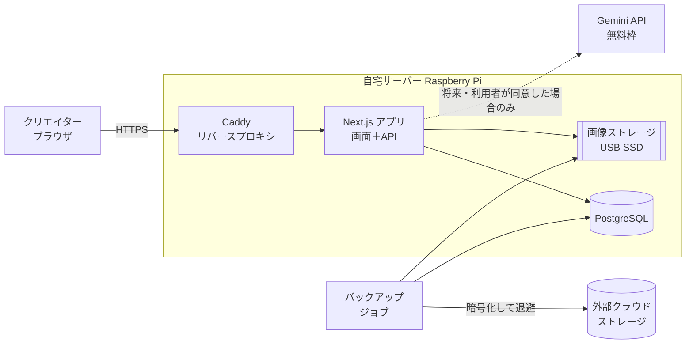

# 基本設計書

| 項目 | 内容 |
|---|---|
| システム名 | Artリーブ |
| 文書番号 | C101-01 |
| 版 | ver1.0 |
| 関連文書 | 機能定義書 ver2.0、関連設計書一覧 |

---

## 1. 目的と範囲

本書は、機能定義書で定義した機能（F-01〜F-16）を実現するためのシステム全体の構成・方針を定める。画面・データ・API・インフラの各詳細設計書は、本書の方針に従って作成する。

対象範囲は、Webアプリケーション本体、データベース、画像ストレージ、自宅サーバー（Raspberry Pi）上の実行環境とする。

---

## 2. システム全体像



詳細は「08_インフラ・ネットワーク構成図」を参照。

---

## 3. アーキテクチャ

Next.js（App Router）1つのアプリケーションで、画面とAPIの両方を提供する。内部は次の4層に分け、層をまたぐ依存は上から下の一方向のみとする。

| 層 | 役割 | 主な実装 |
|---|---|---|
| プレゼンテーション層 | 画面表示・ユーザー操作 | React Server Components、Client Components、Tailwind CSS、React Flow |
| アプリケーション層 | リクエスト受付、入力検証、認可 | Route Handlers（`/api/v1/*`）、Server Actions、Zod |
| ドメイン層 | 業務ルール（変更履歴の記録、画像処理、エクスポート等） | `src/server/services/*` |
| データアクセス層 | DB・ファイルへの読み書き | Prisma Client、ファイルストレージモジュール |

方針：
- 画面からのデータ更新はServer Actionsを基本とし、外部から呼ばれる可能性のある処理（画像配信、エクスポート、将来の公開ページ等）はRoute Handlersとして提供する。どちらも同じドメイン層のサービスを呼ぶため、処理内容は一致する。
- 入力検証スキーマ（Zod）はフロントとサーバーで共有し、検証ルールの食い違いを防ぐ。

---

## 4. サブシステム構成

| サブシステム | 含まれる機能 | 概要 |
|---|---|---|
| 認証 | F-01 | 登録・ログイン・パスワード再設定 |
| 図鑑 | F-02、F-03、F-04、F-09 | キャラクター・タグ・検索・イラスト |
| 世界観 | F-05、F-06 | 用語集ツリー・エピソード |
| 関係 | F-07 | 相関図 |
| 制作支援 | F-08、F-10、F-11 | サイドバー・カラーパレット・マネキン |
| 設定履歴 | F-13 | 変更履歴の記録・差分・復元 |
| 出力・設定 | F-12、F-14 | テーマ切替・PDF／画像書き出し |
| 公開・矛盾チェック（将来） | F-15、F-16 | 公開共有・矛盾検知（自作のルールチェック＋任意のAIチェック） |

---

## 5. 開発フェーズ

機能定義書の優先度に合わせて段階的にリリースする。

| フェーズ | 対象機能 | 完了の目安 |
|---|---|---|
| Phase 1（MVP） | F-01、F-02、F-03、F-04、F-05、F-09、F-13 | キャラクターと世界観を登録・検索でき、変更履歴が残る |
| Phase 2 | F-06、F-07、F-08、F-10、F-11 | 制作支援（サイドバー・パレット・マネキン）と相関図が使える |
| Phase 3 | F-12、F-14 | テーマ切替と書き出しが使える |
| 将来拡張 | F-15、F-16 | 公開共有、矛盾検知（ルールチェックを先に作り、AIチェックは後から追加） |

ダーク基調のUIはフェーズに関係なく最初から適用する（テーマの「切替」機能のみPhase 3）。

---

## 6. 共通方針

### 6.1 認証・認可
- 認証はAuth.js（Credentialsプロバイダー＋JWTセッション）で行う。パスワードはargon2idでハッシュ化して保存する。
- すべてのデータは`user_id`（またはキャラクター経由で`user_id`）に紐づく。データ取得時は必ずログインユーザーのIDで絞り込み、他ユーザーのデータは「存在しない（404）」として扱う。
- 認可チェックはデータアクセス層の共通関数で行い、個別の処理で書き忘れが起きないようにする。

### 6.2 変更履歴（F-13）
- キャラクター、用語、エピソード、相関関係、カラーパレット、マネキン、タグの作成・更新・削除時に、変更前後のスナップショットを`change_histories`へ記録する。
- 記録はデータ更新と同一トランザクションで行い、「更新されたのに履歴がない」状態を作らない。

### 6.3 入力検証
- すべての入力はZodスキーマで検証する。文字数上限はテーブル設計書の桁数に合わせる。
- 画像はファイル拡張子ではなく、ファイル先頭のバイト列（マジックナンバー）で形式を判定する。

### 6.4 エラー処理
- APIのエラーは共通形式（API設計書 2.4）で返す。
- 画面では、入力エラーは項目の近くに、システムエラーはトースト通知で表示する。想定外のエラーはサーバーログに記録し、利用者には詳細を出さない。

### 6.5 日時
- DBにはUTCで保存し、画面ではAsia/Tokyoで表示する。

### 6.6 ログ
- アプリケーションログは標準出力にJSON形式で出し、Dockerのログ機能で保存・ローテーションする（運用手順書参照）。
- パスワード・トークン等の機密値はログに出さない。

---

## 7. ディレクトリ構成（アプリケーション）

```
artleave/
├─ docker-compose.yml          # 本番用
├─ docker-compose.dev.yml      # 開発用（DBのみ）
├─ Caddyfile
├─ prisma/
│   ├─ schema.prisma
│   ├─ migrations/
│   └─ seed.ts                 # 開発・テスト用のサンプルデータ（ポーズマスタはマイグレーションで投入）
├─ scripts/                    # バックアップ等のバッチ
├─ src/
│   ├─ app/                    # 画面（App Router）と Route Handlers
│   │   ├─ (auth)/             # ログイン・登録画面
│   │   ├─ (main)/             # ログイン後の画面
│   │   └─ api/v1/             # API
│   ├─ components/             # 共通UI部品（サイドバー等）
│   ├─ server/
│   │   ├─ services/           # ドメイン層
│   │   ├─ repositories/       # データアクセス層
│   │   └─ storage/            # 画像ファイル操作
│   ├─ schemas/                # Zodスキーマ（フロント・サーバー共用）
│   └─ lib/                    # 認証設定、共通関数
└─ tests/
```

---

## 8. 関連設計書との対応

| 観点 | 参照先 |
|---|---|
| 画面 | 02_画面設計書 |
| 操作の流れ | 03_ユースケース図・シーケンス図 |
| データ | 04_テーブル設計書、05_ER図 |
| API | 06_API設計書 |
| 非機能・方式 | 07_非機能要件定義書・方式設計書 |
| インフラ | 08_インフラ・ネットワーク構成図 |
| 状態管理 | 09_状態遷移図 |
| 定期処理 | 10_バッチ処理設計書 |
| テスト | 11_テスト計画書・仕様書 |
| 運用 | 12_運用・保守・障害対応手順書、13_環境構築・デプロイ手順書、14_バックアップ・リストア手順書 |
