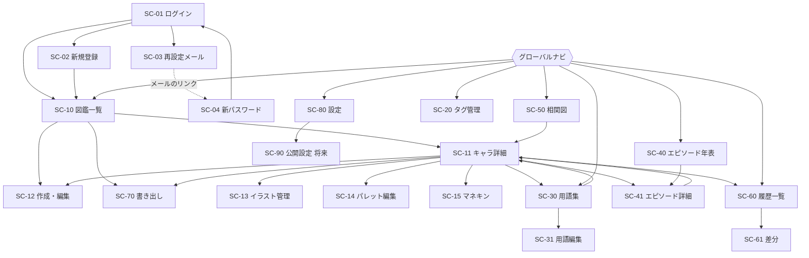

# 画面設計書

| 項目 | 内容 |
|---|---|
| システム名 | Artリーブ |
| 文書番号 | C101-02 |
| 版 | ver1.0 |
| 関連文書 | 01_基本設計書、06_API設計書 |

---

## 1. デザイン方針

| 項目 | 方針 |
|---|---|
| コンセプト | 「ゲームの公式キャラクター図鑑を開いたような」没入感。イラストを主役にし、文字情報は脇に控えさせる |
| 基本テーマ | ダーク基調（背景はほぼ黒の紺、文字はオフホワイト、アクセントは淡い金色）。ライトテーマはF-12で切替 |
| 色の扱い | 配色はCSS変数で定義し、テーマ切替は変数の差し替えだけで行う |
| 動き | 画面遷移はフェードイン（200ms前後）、カードはホバーでわずかに浮く程度。例外としてSC-11（キャラ詳細）は本をめくる演出を入れる（SC-11「本の演出」参照）。動きを減らす設定（prefers-reduced-motion）の利用者にはアニメーションを止める |
| 対応端末 | PC（1280px以上）を主対象。タブレット（768px以上）でも崩れずに使える。スマートフォンは閲覧のみ想定 |
| 文字 | 見出しは明朝系、本文はゴシック系（Google Fonts） |

---

## 2. 共通レイアウト

```
┌──────────────────────────────────────────────────────────┐
│ ヘッダー：ロゴ ／ 検索ボックス ／ サイドバー呼出ボタン ／ ユーザーメニュー │
├────────┬─────────────────────────────────────┬───────────┤
│ グローバル │                                         │ リファレンス │
│ ナビ      │          メインエリア                     │ サイドバー   │
│ ・図鑑    │                                         │ （必要時に   │
│ ・世界観  │                                         │  右からスライド│
│ ・エピソード│                                        │  イン）      │
│ ・相関図  │                                         │           │
│ ・タグ    │                                         │           │
│ ・履歴    │                                         │           │
│ ・設定    │                                         │           │
└────────┴─────────────────────────────────────┴───────────┘
```

- グローバルナビは折りたたみ可能。タブレット幅では自動でアイコン表示に縮む。
- リファレンスサイドバー（CMP-01）はどの画面からでもヘッダーのボタン、またはキーボードの`]`キーで開閉できる。

---

## 3. 画面一覧

| 画面ID | 画面名 | URL | 機能 | ログイン |
|---|---|---|---|---|
| SC-01 | ログイン | /login | F-01 | 不要 |
| SC-02 | 新規登録 | /signup | F-01 | 不要 |
| SC-03 | パスワード再設定（メール入力） | /password-reset | F-01 | 不要 |
| SC-04 | パスワード再設定（新パスワード入力） | /password-reset/[token] | F-01 | 不要 |
| SC-10 | キャラクター図鑑（一覧） | / | F-02、F-04 | 必要 |
| SC-11 | キャラクター詳細（鑑賞モード） | /characters/[id] | F-02、F-09、F-10、F-11 | 必要 |
| SC-12 | キャラクター作成・編集 | /characters/new、/characters/[id]/edit | F-02、F-03 | 必要 |
| SC-13 | イラスト管理（モーダル） | SC-11上で表示 | F-09 | 必要 |
| SC-14 | カラーパレット編集（モーダル） | SC-11上で表示 | F-10 | 必要 |
| SC-15 | マネキン作成・編集 | /characters/[id]/mannequin | F-11 | 必要 |
| SC-20 | タグ管理 | /tags | F-03 | 必要 |
| SC-30 | 世界観・用語集 | /terms、/terms/[id] | F-05 | 必要 |
| SC-31 | 用語作成・編集 | /terms/new、/terms/[id]/edit | F-05 | 必要 |
| SC-40 | エピソード年表 | /episodes | F-06 | 必要 |
| SC-41 | エピソード詳細・編集 | /episodes/[id]、/episodes/new | F-06 | 必要 |
| SC-50 | 相関図 | /relationships | F-07 | 必要 |
| SC-60 | 変更履歴一覧 | /histories | F-13 | 必要 |
| SC-61 | 変更差分 | /histories/[id] | F-13 | 必要 |
| SC-70 | 書き出し（モーダル） | SC-10・SC-11上で表示 | F-14 | 必要 |
| SC-80 | 設定 | /settings | F-12 | 必要 |
| SC-90 | 公開設定（将来） | /settings/public | F-15 | 必要 |
| SC-91 | 公開ページ（将来） | /p/[slug] | F-15 | 不要 |
| CMP-01 | リファレンスサイドバー（共通部品） | 全画面 | F-08 | 必要 |
| CMP-02 | 矛盾チェック結果パネル（将来・共通部品） | 編集画面 | F-16 | 必要 |

---

## 4. 画面遷移図



リファレンスサイドバー（CMP-01）は遷移ではなく、全画面の上に重ねて表示する。

---

## 5. 画面詳細

### SC-01 ログイン

| 項目 | 種類 | 必須 | 備考 |
|---|---|---|---|
| メールアドレス | テキスト | ○ | |
| パスワード | パスワード | ○ | 表示切替アイコン付き |
| ログイン | ボタン | | 失敗時は「メールアドレスまたはパスワードが違います」（どちらが違うかは出さない） |
| 新規登録へ／パスワードを忘れた方 | リンク | | |

背景にはぼかしたイメージ画像を敷き、ログインカードだけを中央に置く。

### SC-02 新規登録

表示名・メールアドレス・パスワード・パスワード（確認）を入力。パスワード条件（8文字以上、英字と数字を含む）は入力中にチェック結果を表示する。登録後はSC-10へ。

### SC-03／SC-04 パスワード再設定

SC-03でメールアドレスを送信すると「登録されている場合はメールを送信しました」と表示（登録有無は出さない）。メール内リンクからSC-04を開き、新パスワードを設定するとSC-01へ戻る。トークン切れの場合はSC-03へ誘導するメッセージを表示。

### SC-10 キャラクター図鑑（一覧）

```
┌───────────────────────────────────────────────┐
│ 図鑑                          [＋ 新しいキャラ] [書き出し] │
│ [キーワード    ] [種族▼] [陣営▼] [タグ: 主人公× 騎士団× ＋] │
│ 並び替え：[更新日▼]   表示：[カード｜リスト]              │
├───────────────────────────────────────────────┤
│ ┌──────┐ ┌──────┐ ┌──────┐ ┌──────┐     │
│ │ 立ち絵  │ │      │ │      │ │      │     │
│ │        │ │      │ │      │ │      │     │
│ │ リリア  │ │ ガイ  │ │ ...  │ │ ...  │     │
│ │ エルフ  │ │      │ │      │ │      │     │
│ └──────┘ └──────┘ └──────┘ └──────┘     │
└───────────────────────────────────────────────┘
```

| 要素 | 内容 |
|---|---|
| キャラクターカード | メインイラスト（縦長）、名前、種族。ホバーで所属陣営とタグを表示 |
| 検索・絞り込み | キーワード・種族・陣営・タグ（複数選択はAND）。条件はURLのクエリに反映し、ブラウザの戻るで復元できる |
| 0件のとき | 初回は「最初のキャラクターを登録しましょう」と作成ボタンを大きく表示。検索で0件なら条件のクリアを促す |
| 書き出し | 選択モードに切り替え、チェックしたキャラをSC-70へ渡す |

### SC-11 キャラクター詳細（鑑賞モード）

```
┌───────────────────────────────────────────────┐
│ ← 図鑑へ                  [編集] [サイドバーに固定] [︙]   │
├───────────────────────┬───────────────────────┤
│                        │ リリア  Lilia               │
│   ［メインイラスト］     │ エルフ／白銀騎士団／17       │
│   大きく表示            │ #主人公 #騎士団              │
│                        │ ─────────────────     │
│  ◀ 立ち絵 表情 衣装 ▶   │ 性格                         │
│  （サムネイル列）        │ プロフィール                  │
│                        │ 関連用語：白銀騎士団 / 王都   │
├───────────────────────┴───────────────────────┤
│ タブ：［カラーパレット］［マネキン］［エピソード］［関係］［履歴］ │
│ ■#C9D6FF 髪  ■#4A7BD0 瞳  ■#F6DCCB 肌 ...  [編集]       │
└───────────────────────────────────────────────┘
```

| 要素 | 内容 |
|---|---|
| イラスト表示 | サムネイルをクリック／左右キーでスライド切替。クリックで全画面表示 |
| 情報エリア | プロフィールを見出し付きで表示。関連用語はクリックでSC-30へ |
| タブ | カラーパレット（SC-14で編集）、マネキン（SC-15へ）、エピソード（関連エピソード一覧）、関係（このキャラを中心にした相関図の簡易表示）、履歴（このキャラの変更履歴） |
| ︙メニュー | イラスト管理（SC-13）、書き出し（SC-70）、削除（確認ダイアログ） |
| サイドバーに固定 | このキャラをCMP-01で表示する |

#### 見た目：図鑑の見開きページ

キャラ詳細は「図鑑の見開き1ページ」として表示する（Figma「案A／キャラ詳細（本）」）。

```
          ‖しおり
┌─────────────┬─────────────┐┐
│ ［立ち絵の写真］ │ CHARACTER FILE No.001 ││プロフィール
│  テープで貼る   │ リリア  Lilia          ││マネキン
│               │ エルフ／白銀騎士団／17   ││エピソード
│ ［差分の小さな写真］│ 性格・プロフィール       ││関係
│               │ カラーパレット           ││履歴
│     — 12 —    │     — 13 —            │┘ ← インデックスタブ
└─────────────┴─────────────┘
‹ 前のキャラ                         次のキャラ ›
```

| 要素 | 内容 |
|---|---|
| 左ページ | メインイラスト（写真風）と差分イラスト。従来の「イラスト表示」と同じ操作 |
| 右ページ | プロフィール（従来の「情報エリア」）と、選んだタブの内容 |
| インデックスタブ | 従来のタブ（プロフィール・マネキン・エピソード・関係・履歴）を本の右端の見出しとして表示 |
| ページ送り | 図鑑の並び順で前後のキャラへ移動（URLは /characters/[id] のまま） |
| スマートフォン・タブレット縦 | 見開きをやめ、1ページずつ表示（左ページ→右ページの順に縦に並べる） |

#### 本の演出

| 場面 | 動き | 時間の目安 |
|---|---|---|
| 最初に開くとき（図鑑一覧から来たとき） | 閉じた本が中央に現れる → 右側のページが数枚パラパラとめくれる → 表紙が開いて見開きになり、そのキャラのページで止まる | 全体で1.2秒以内 |
| 前後のキャラへ移動 | 右ページが綴じ目を軸にめくれて次のキャラへ（前へは逆向き）。左右キー・スワイプでも操作できる | 1回0.6秒前後 |
| インデックスタブの切り替え | 右ページだけを1枚めくって内容を切り替える | 0.4秒前後 |
| 2回目以降 | 同じ閲覧中（タブを閉じるまで）にパラパラ演出を見た後は、詳細を開くときに軽い開き動作だけにする。演出中にクリックやキー操作をすると即座に完了させる | 0.3秒前後 |
| 動きを減らす設定（prefers-reduced-motion） | めくり・パラパラは行わず、フェードで切り替える | 0.2秒 |

実装方針：

- めくりはCSSの3D変形（綴じ目を軸にした`rotateY`、`perspective`、裏面を隠す`backface-visibility`）で作り、ページの裏に影のグラデーションを重ねて紙らしく見せる。動きの順番の制御にはMotion（React向けアニメーションライブラリ）を使う。
- パラパラ用のページは中身のない紙だけを使い、本物のページ（イラスト・プロフィール）はめくり終わってから表示する。画像の読み込みを演出の時間内に済ませ、待ち時間を感じさせない狙いもある。
- 動かすのは`transform`と`opacity`だけにして、低性能な端末でもカクつかないようにする。
- 前後のキャラのデータは、ページ送りボタンが表示された時点で先読みしておく。

### SC-12 キャラクター作成・編集

| 項目 | 種類 | 必須 | 備考 |
|---|---|---|---|
| 名前 | テキスト | ○ | 100文字 |
| よみがな | テキスト | | |
| 年齢 | テキスト | | 「不明」なども可 |
| 種族 | テキスト（候補表示） | | 既存の値を候補に出し、表記ゆれを防ぐ |
| 所属陣営 | テキスト（候補表示） | | 同上 |
| 性格 | 複数行テキスト | | |
| プロフィール | 複数行テキスト | | |
| タグ | タグ選択 | | その場で新規タグも作成可 |
| 関連用語 | 用語選択 | | ツリーから選択 |

- 保存せずに離れようとした場合は確認ダイアログを出す。
- 将来はCMP-02（矛盾チェック）をこの画面の右側に表示する。

### SC-13 イラスト管理（モーダル）

- 画像をドラッグ＆ドロップ、またはファイル選択で追加（複数可）。アップロード中は進捗を表示。
- 各イラストに種類ラベル（立ち絵／表情差分／衣装違い／その他）とキャプションを設定。
- ドラッグで並び替え、メインイラストの指定、差し替え、削除ができる。
- 20MB超・非対応形式はアップロード前にエラーを表示。

### SC-14 カラーパレット編集（モーダル）

- カラーピッカー＋HEX直接入力で色を追加。用途（肌／髪／瞳／衣装／その他）と色名を設定。
- ドラッグで並び替え。色をクリックするとカラーコードをクリップボードにコピー。

### SC-15 マネキン作成・編集

```
┌──────────────────────────┬──────────────────┐
│                           │ 身長     [158] cm    │
│    シルエットのプレビュー    │ 頭身     ──●── 6.5  │
│    （頭身ガイド線つき）      │ 体格     [細身▼]     │
│                           │ 肌の色   ■ [#F6DCCB] │
│   比較：[他のキャラを重ねる▼] │ ポーズ   [直立▼]     │
│                           │ [保存] [他キャラへ複製] │
└──────────────────────────┴──────────────────┘
```

- パラメータを動かすとプレビューが即座に変わる（保存前でも確認できる）。
- 「他のキャラを重ねる」で別キャラのマネキンを半透明で並べ、身長差を確認できる。

### SC-20 タグ管理

タグ名・分類・使用キャラ数の一覧。行内で名前と分類を編集。削除時は「◯人のキャラクターから外れます」と確認する。

### SC-30 世界観・用語集

左側に用語ツリー（開閉可能、ドラッグで親子・順番を変更）、右側に選択した用語の詳細（パンくず、説明、下位の用語、関連キャラ、関連エピソード）を表示する。子を持つ用語の削除ボタンは無効化し、理由をツールチップで表示する。

### SC-31 用語作成・編集

用語名（必須）、親用語（ツリーから選択）、説明、関連キャラクターを入力する。

### SC-40 エピソード年表

作中時系列（story_order）順に縦のタイムラインで表示。作中時期ラベルを見出しに、関わるキャラのアイコンを並べる。キャラ・用語で絞り込める。並び順「作成順」にも切替可。

### SC-41 エピソード詳細・編集

タイトル（必須）、作中時期ラベル、時系列の並び順、本文、関わるキャラクター、関連用語を入力・表示する。

### SC-50 相関図

```
┌───────────────────────────────────────────────┐
│ 相関図   表示：[全員▼][タグ▼]  [＋関係を追加] [自動整列]   │
├───────────────────────────────────────────────┤
│        (リリア) ──ライバル── (ガイ)                     │
│           │                    │                       │
│          姉                   宿敵                      │
│           │                    │                       │
│        (ミナ)              (黒の王)                      │
│                                     [ミニマップ][＋][－]│
└───────────────────────────────────────────────┘
```

| 操作 | 内容 |
|---|---|
| 関係の追加 | ノードの端からドラッグして別のノードへ線をつなぐ → 種類・ラベル・向きを入力 |
| 線の色 | 関係の種類ごとに色分け（敵対＝赤系、血縁＝金系、友人＝青系 など）。色だけに頼らずラベルも表示 |
| ノードの移動 | ドラッグで移動し、離した時点で位置を保存 |
| 自動整列 | 保存済みの位置をリセットして自動レイアウト |
| ノードのクリック | SC-11へ遷移 |

### SC-60 変更履歴一覧

日時・対象（種類アイコン＋名前）・操作（作成／更新／削除／復元）・変更項目を新しい順に表示。対象の種類と期間で絞り込める。

### SC-61 変更差分

項目ごとに「変更前」「変更後」を左右に並べ、長文は追加部分を緑、削除部分を赤で表示する。「この変更の前に戻す」ボタンで確認ダイアログを出し、復元する。

### SC-70 書き出し（モーダル）

対象キャラ（SC-10で選択済み、またはSC-11の1人）、形式（PDF／PNG）、含める項目（プロフィール・イラスト・パレット・マネキン）を選び、ダウンロードする。

### SC-80 設定

テーマ（ダーク／ライト）、表示名、パスワード変更、ログアウト。テーマは選んだ瞬間に画面へ反映する。

将来（F-16）は「AIチェックを使う」スイッチを追加する（初期状態はオフ）。オンにするときは確認ダイアログで次を説明し、「同意してオンにする」を押した場合のみ有効にする。

- AIチェックでは、キャラクター・用語・エピソードの文章がGoogleのGemini APIに送られること
- 無料で提供するため、送った内容がGoogleのサービス改善に使われること
- 画像とアカウント情報は送らないこと、オフにすればそれ以降は送らないこと
- オフのままでも、ルールによるチェックは使えること

### SC-90／SC-91 公開設定・公開ページ（将来）

SC-90で公開URL・公開範囲（非公開／限定公開／一般公開）・パスワードを設定する。SC-91は編集機能を除いたSC-10・SC-11相当の閲覧専用ページ。

### CMP-02 矛盾チェック結果パネル（将来）

SC-12・SC-31・SC-41（編集画面）の右側に表示する。「矛盾をチェック」ボタンで実行する。

| 要素 | 内容 |
|---|---|
| ルールの指摘 | すぐに表示。ルール名（例：「色の食い違い」）、指摘文、根拠となった設定へのリンク |
| AIの指摘 | AIチェックがオンのときのみ表示。「AI」の目印を付け、根拠となった設定の引用を添える。チェック中はスピナー、失敗時は理由と再実行ボタン |
| 操作 | 各指摘の「該当箇所へ移動」「この指摘を閉じる」。修正するかどうかは利用者が決める |
| AIがオフのとき | パネル下部に「文章の矛盾もチェックするには設定でAIチェックをオンにしてください」と小さく案内 |

### CMP-01 リファレンスサイドバー

```
┌──────────────┐
│ リリア ▼  [📌][×] │ ← キャラ切替・ピン留め・閉じる
├──────────────┤
│ 衣装  ◀ 正装 ▶     │
│ ［衣装イラスト］    │
├──────────────┤
│ パレット           │
│ ■髪 ■瞳 ■肌 ■衣装 │ ← クリックでコードをコピー
├──────────────┤
│ マネキン           │
│ ［シルエット］ 158cm│
│ 6.5頭身            │
└──────────────┘
```

| 項目 | 仕様 |
|---|---|
| 表示方法 | 画面右端からスライドイン。メイン画面を押しのけず上に重ねる |
| 幅 | 320px（ドラッグで280〜480pxに変更可） |
| 開閉 | ヘッダーのボタン／`]`キー |
| 表示キャラ | 最後に表示したキャラを記憶（user_settings.sidebar_character_id） |
| 操作の邪魔をしない | サイドバー表示中もメイン画面のスクロール・入力は通常どおり行える |
