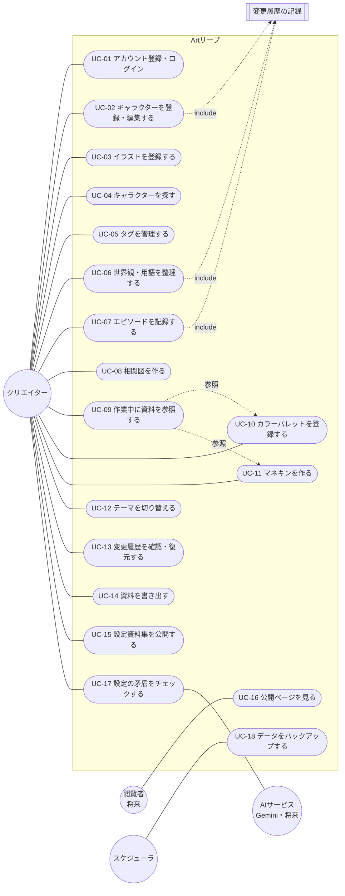
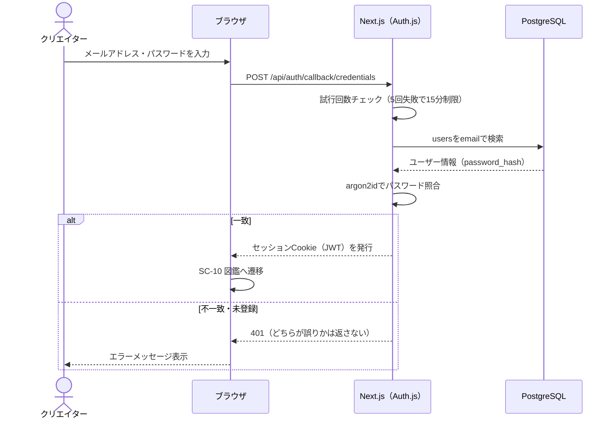
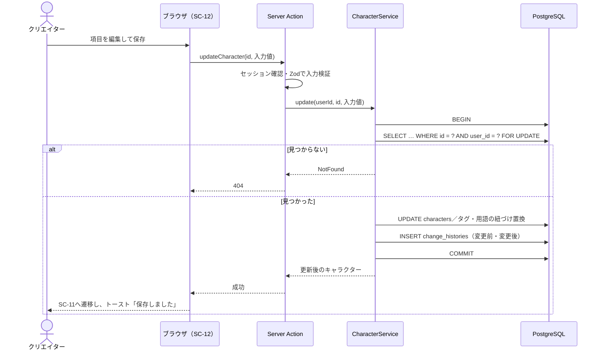
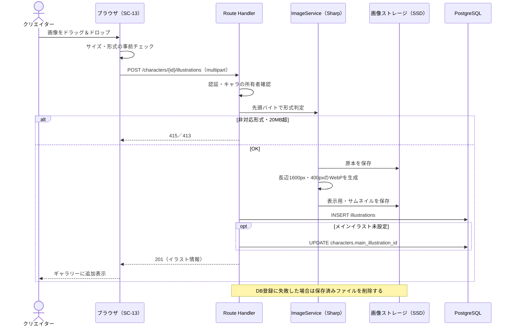
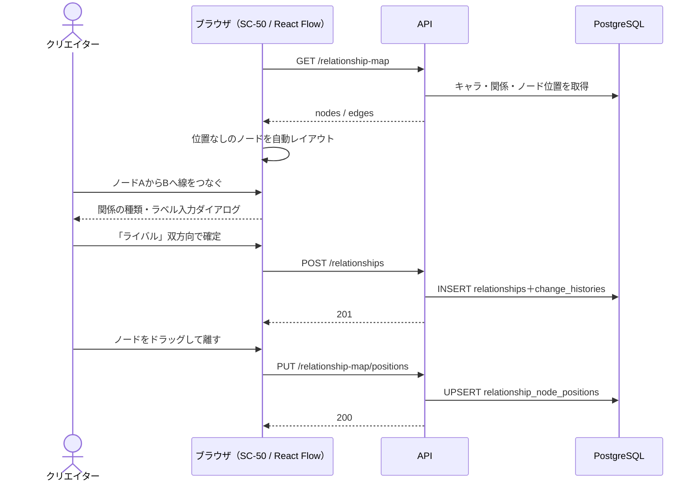
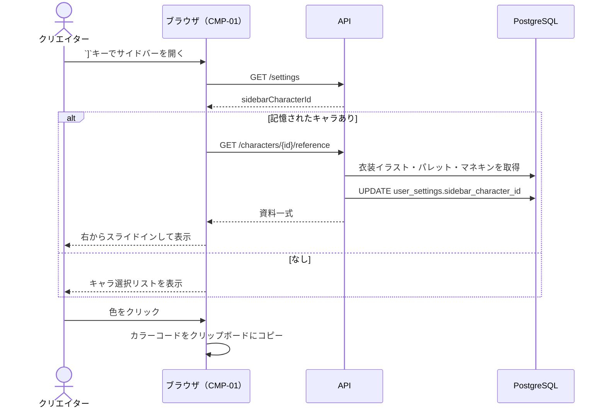
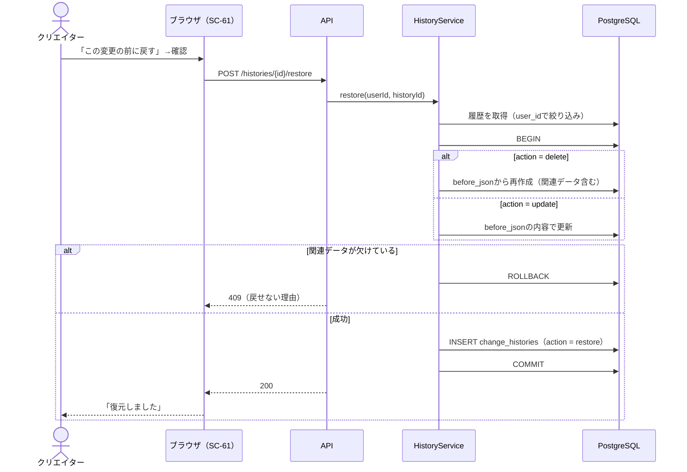
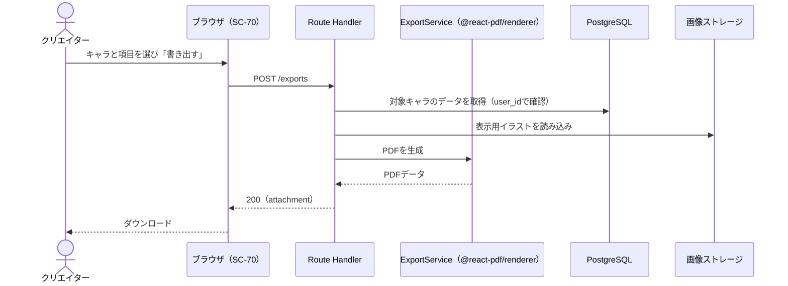
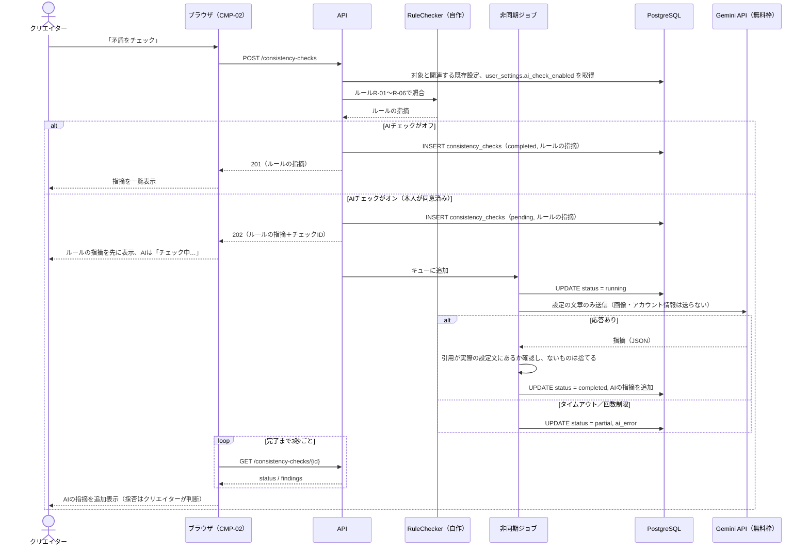
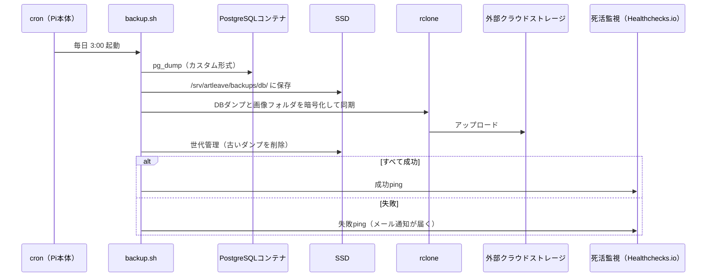

# ユースケース図・シーケンス図

| 項目 | 内容 |
|---|---|
| システム名 | Artリーブ |
| 文書番号 | C101-03 |
| 版 | ver1.0 |
| 関連文書 | 02_画面設計書、06_API設計書 |

---

## 1. アクター

| アクター | 説明 |
|---|---|
| クリエイター | サービスの利用者。自分のキャラクター・世界観を登録・閲覧する |
| 閲覧者（将来） | 公開された設定資料集を見る第三者（F-15） |
| AIサービス（将来） | 文章の矛盾チェックを行う外部のGemini API（F-16）。利用者が同意してオンにした場合のみ使う |
| スケジューラ | 自宅サーバー上で定期実行されるバッチ（バックアップ等） |

---

## 2. ユースケース図

※ Mermaidにはユースケース図の専用記法がないため、フローチャートで表現している。

---

## 3. ユースケース一覧

| ID | ユースケース | アクター | 機能 | 主な画面 |
|---|---|---|---|---|
| UC-01 | アカウント登録・ログイン | クリエイター | F-01 | SC-01〜04 |
| UC-02 | キャラクターを登録・編集する | クリエイター | F-02 | SC-11、SC-12 |
| UC-03 | イラストを登録する | クリエイター | F-09 | SC-13 |
| UC-04 | キャラクターを探す | クリエイター | F-04 | SC-10 |
| UC-05 | タグを管理する | クリエイター | F-03 | SC-20 |
| UC-06 | 世界観・用語を整理する | クリエイター | F-05 | SC-30、SC-31 |
| UC-07 | エピソードを記録する | クリエイター | F-06 | SC-40、SC-41 |
| UC-08 | 相関図を作る | クリエイター | F-07 | SC-50 |
| UC-09 | 作業中に資料を参照する | クリエイター | F-08 | CMP-01 |
| UC-10 | カラーパレットを登録する | クリエイター | F-10 | SC-14 |
| UC-11 | マネキンを作る | クリエイター | F-11 | SC-15 |
| UC-12 | テーマを切り替える | クリエイター | F-12 | SC-80 |
| UC-13 | 変更履歴を確認・復元する | クリエイター | F-13 | SC-60、SC-61 |
| UC-14 | 資料を書き出す | クリエイター | F-14 | SC-70 |
| UC-15 | 設定資料集を公開する（将来） | クリエイター | F-15 | SC-90 |
| UC-16 | 公開ページを見る（将来） | 閲覧者 | F-15 | SC-91 |
| UC-17 | 設定の矛盾をチェックする（将来） | クリエイター、AIサービス（任意） | F-16 | CMP-02、SC-80 |
| UC-18 | データをバックアップする | スケジューラ | — | — |

---

## 4. 代表的なユースケース記述

### UC-09 作業中に資料を参照する

| 項目 | 内容 |
|---|---|
| 目的 | イラスト制作中に、作業を止めずに衣装・色・体型を確認する |
| 事前条件 | ログイン済み。対象キャラにイラスト・パレット・マネキンのいずれかが登録済み |
| 基本フロー | 1. 任意の画面でサイドバーを開く 2. 前回表示していたキャラの資料が表示される 3. 衣装イラストを切り替えて確認する 4. 色をクリックしてカラーコードをコピーし、お絵描きソフトに貼り付ける 5. サイドバーを閉じる |
| 代替フロー | 2a. 初めて開いた場合はキャラ選択リストを表示する |
| 事後条件 | 表示していたキャラが記憶される |

### UC-13 変更履歴を確認・復元する

| 項目 | 内容 |
|---|---|
| 目的 | 「前はどういう設定だったか」を確認し、必要なら元に戻す |
| 事前条件 | ログイン済み。対象データに1回以上の変更がある |
| 基本フロー | 1. キャラ詳細の履歴タブ、または履歴一覧を開く 2. 日時を選んで差分を表示する 3. 「この変更の前に戻す」を押し、確認する 4. 内容が戻り、復元自体も履歴に残る |
| 代替フロー | 3a. 関連データが既に削除されていて戻せない場合は、理由を表示して中止する |

---

## 5. シーケンス図

### SQ-01 ログイン（UC-01）

### SQ-02 キャラクター更新と変更履歴の記録（UC-02、F-13）

### SQ-03 イラストのアップロード（UC-03）

### SQ-04 相関図の関係追加と位置保存（UC-08）

### SQ-05 リファレンスサイドバーの表示（UC-09）

### SQ-06 変更履歴からの復元（UC-13）

### SQ-07 PDF書き出し（UC-14）

### SQ-08 矛盾チェック（UC-17、将来）

### SQ-09 夜間バックアップ（UC-18）

