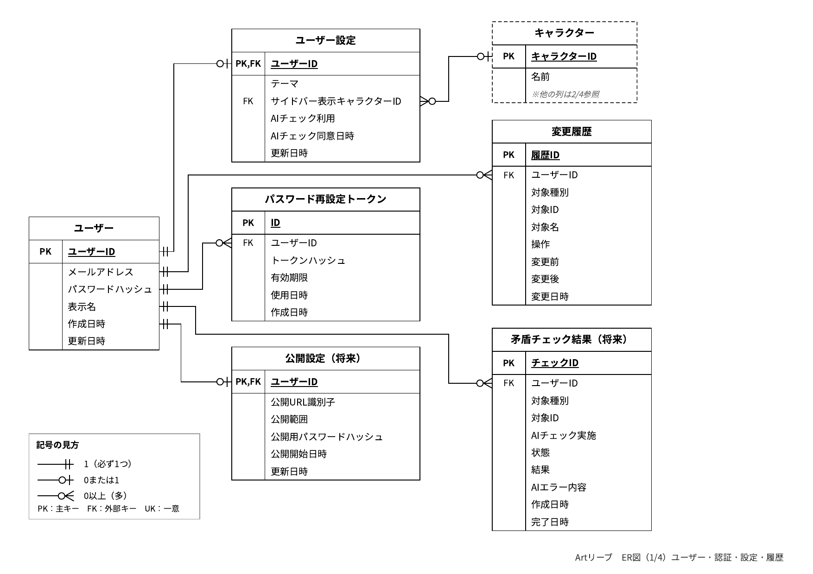
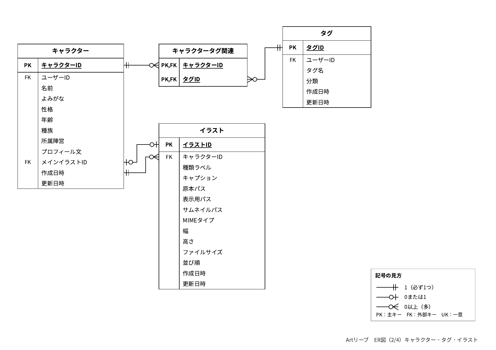
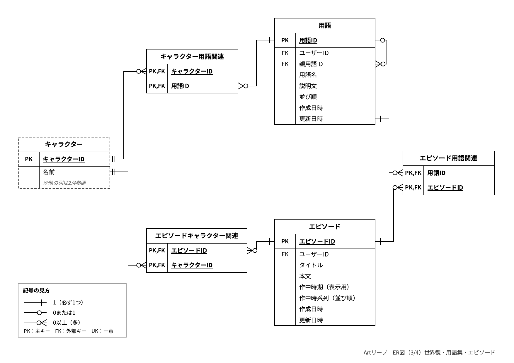
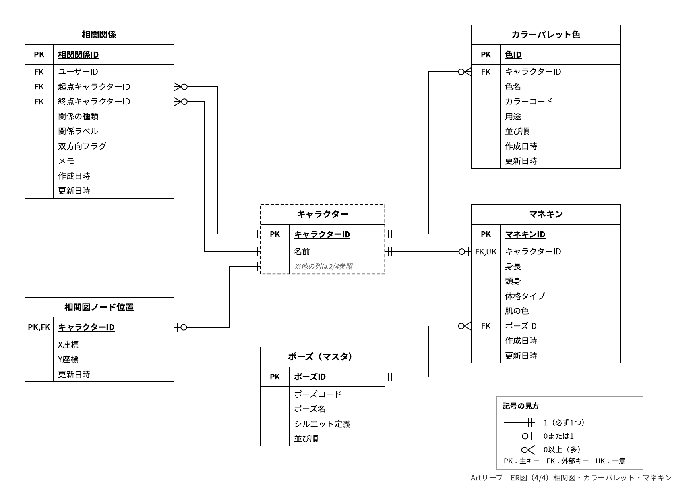

# ER図

| 項目 | 内容 |
|---|---|
| システム名 | Artリーブ |
| 文書番号 | C101-05 |
| 版 | ver2.0 |
| 関連文書 | 04_テーブル設計書 |

## ファイル

| ファイル | 用途 |
|---|---|
| `05_ER図.pdf` | 印刷・提出用（A4横、4ページ） |
| `05_ER図.drawio` | 編集用。draw.io（app.diagrams.net）またはVS Codeの拡張機能「Draw.io Integration」で開く。4ページがタブに分かれている |
| `images/ER図_*.png` | このページに表示している画像 |

テーブルが20個あるため、分野ごとに4ページに分けている。項目名は論理名（日本語）で記載し、型・桁数・制約はテーブル設計書を参照。どのテーブルもユーザーに属する（ユーザーIDを外部キーに持つ）が、図が複雑になるため、ユーザーとの線は1ページ目のテーブルにだけ引いている。

点線の枠のテーブルは、別のページに載っているテーブルを参照用に小さく載せたもの。

## 記号の見方

| 記号 | 意味 |
|---|---|
| ─┼┼ | 1（必ず1つ） |
| ─○┼ | 0または1 |
| ─○＜ | 0以上（多） |
| PK／FK／UK | 主キー／外部キー／一意 |

---

## 1/4 ユーザー・認証・設定・履歴

## 2/4 キャラクター・タグ・イラスト（F-02〜F-04、F-09）

キャラクターとタグは多対多のため、中間テーブル「キャラクタータグ関連」で結ぶ。イラストの実物はSSDに保存し、DBには保存場所（パス）だけを記録する。キャラクターの「メインイラストID」は一覧のサムネイル用で、0または1枚。

## 3/4 世界観・用語集・エピソード（F-05、F-06）

用語は「親用語ID」で自分自身のテーブルを参照し、「世界 > 国 > 都市」のような深さの決まっていない階層を1つのテーブルで表す（用語テーブル右側の線）。

## 4/4 相関図・カラーパレット・マネキン（F-07、F-10、F-11）

キャラクター同士の関係は、「兄」「宿敵」のように関係そのものが情報を持つため、種類・ラベル・向きを持つ「相関関係」テーブルとして独立させた。キャラクターからの線が2本あるのは、起点と終点の両方がキャラクターだから。

---

## 設計上のポイント

| ポイント | 理由 |
|---|---|
| 全データをユーザーIDに紐づける | 他人のデータを見られないよう、必ずログインユーザーのIDで絞り込めるようにするため |
| 多対多は中間テーブルで表す | キャラとタグ、キャラと用語、エピソードとキャラ・用語は、どちらから見ても複数になるため |
| 相関関係は独立したテーブル | 関係そのものが種類・ラベル・向きという情報を持つため |
| 用語集は自己参照 | 階層の深さが決まっていないため |
| 変更履歴の「対象ID」は外部キーにしない | 対象が削除された後も履歴を残し、復元できるようにするため（代わりに「対象名」で削除後も名前を表示する） |
| 将来機能は別テーブル | 公開設定・矛盾チェック結果を、既存のテーブルを変えずに追加できるようにするため |
