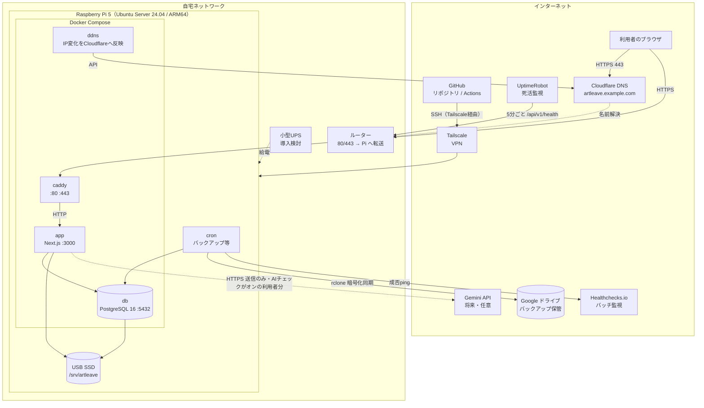
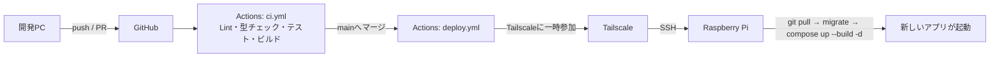

# インフラ・ネットワーク構成図

| 項目 | 内容 |
|---|---|
| システム名 | Artリーブ |
| 文書番号 | C101-08 |
| 版 | ver1.0 |
| 関連文書 | 機能定義書「8. 本番環境」、13_環境構築・デプロイ手順書 |

---

## 1. 全体構成図



---

## 2. ハードウェア構成

| 機器 | 仕様 | 用途 | 概算費用 |
|---|---|---|---|
| Raspberry Pi 5 | メモリ8GB | アプリ・DBの実行 | 約14,000円 |
| 公式電源アダプタ | USB-C 27W | 安定給電（容量不足は不安定の原因になるため公式品） | 約2,000円 |
| ケース（ファン付き） | アクティブクーラー対応 | 常時稼働時の熱対策 | 約2,000円 |
| USB接続SSD | 256GB以上、USB 3.0 | OS起動・DB・画像・バックアップ | 約4,000円 |
| LANケーブル | Cat6 | 有線接続（Wi-Fiは使わない） | 数百円 |
| 小型UPS（任意） | 出力に余裕のあるもの | 瞬停対策 | 約10,000円〜 |

初期費用はUPSなしで約22,000円。月額費用は電気代（約5W×24時間×30日≒3.6kWh、100円程度）のみで、クラウドの利用料はかからない。

※メモリ4GBでも動作するが、本番コンテナのビルドをPi上で行うため8GBを推奨する。

---

## 3. ソフトウェア構成

| 区分 | ソフトウェア | バージョン | 備考 |
|---|---|---|---|
| OS | Ubuntu Server | 24.04 LTS（ARM64） | 長期サポート版 |
| コンテナ | Docker Engine／Docker Compose | 最新安定版 | |
| リバースプロキシ | Caddy | 2系 | Let's Encryptの証明書を自動取得・更新 |
| アプリ | Node.js／Next.js | Node 22 LTS | `output: "standalone"`でビルドしたものを実行 |
| DB | PostgreSQL | 16 | 公式イメージ（ARM64対応） |
| DDNS | favonia/cloudflare-ddns | 最新 | グローバルIPの変化を検知してDNSを更新 |
| VPN | Tailscale | 最新 | SSHをインターネットに公開しないため |
| バックアップ | rclone | 最新 | 暗号化（crypt）して外部ストレージに同期 |
| ファイアウォール | ufw | — | |

---

## 4. ネットワーク設定

### 4.1 ポート一覧

| 通信 | 送信元 | 宛先 | ポート | 外部公開 |
|---|---|---|---|---|
| Web（HTTP） | インターネット | ルーター→Pi（caddy） | 80 | ○（HTTPSへの転送と証明書取得用） |
| Web（HTTPS） | インターネット | ルーター→Pi（caddy） | 443 | ○ |
| アプリ | caddy | app | 3000 | ×（Dockerの内部ネットワークのみ） |
| DB | app | db | 5432 | ×（Dockerの内部ネットワークのみ） |
| SSH | Tailscale参加端末 | Pi | 22 | ×（Tailscale経由のみ） |
| AIチェック（将来） | app | Gemini API | 443（送信） | —（Piから外への送信のみ。受信ポートは開けない） |

### 4.2 ルーター設定

| 項目 | 設定 |
|---|---|
| Piの固定IP | DHCPの予約機能で固定（例：192.168.1.50） |
| ポート転送 | TCP 80 → 192.168.1.50:80、TCP 443 → 192.168.1.50:443 |
| その他 | UPnPは無効にし、意図しないポート開放を防ぐ |

### 4.3 ufw設定（Pi）

| ルール | 内容 |
|---|---|
| 既定 | 受信を拒否、送信を許可 |
| 許可 | 80/tcp、443/tcp（すべて）、22/tcp（`tailscale0`インターフェースのみ） |

※Dockerはufwのルールを経由せずにポートを開くことがあるため、`docker-compose.yml`では外部に出すポートを80と443（caddy）だけにし、app・dbは`ports`を書かない。

### 4.4 DNS・ドメイン

| 項目 | 設定 |
|---|---|
| ドメイン | 独自ドメイン（年1,500円程度）をCloudflareで管理（DNSのみ利用、無料） |
| レコード | `artleave.example.com` → 自宅のグローバルIP（Aレコード） |
| プロキシ | 初期はDNSのみ（グレー雲）。Caddyが直接証明書を取得する |
| 更新 | ddnsコンテナが5分ごとにIPを確認し、変わっていればレコードを更新 |

注意：DNSのみの設定では、ドメインから自宅のグローバルIPが分かる。気になる場合はCloudflareのプロキシ（オレンジ雲）を有効にし、Caddyには「Cloudflare Origin証明書」を設定する方式に切り替える（13_環境構築・デプロイ手順書 付録）。

---

## 5. コンテナ構成

| サービス | イメージ | 公開ポート | ボリューム | 再起動 |
|---|---|---|---|---|
| migrate | 自前ビルド（buildステージ） | なし | なし | 実行後に終了 |
| caddy | caddy:2 | 80、443 | `./Caddyfile`、`/srv/artleave/caddy` | unless-stopped |
| app | 自前ビルド（Dockerfile） | なし | `/srv/artleave/uploads:/data/uploads` | unless-stopped |
| db | postgres:16 | なし | `/srv/artleave/pgdata:/var/lib/postgresql/data` | unless-stopped |
| ddns | favonia/cloudflare-ddns | なし | なし | unless-stopped |

### 5.1 docker-compose.yml・Caddyfile

リポジトリの`docker-compose.yml`と`Caddyfile`を使う。上の表のサービスに加えて、起動のたびにDBのマイグレーションを行って終了する`migrate`サービスがある（`app`は`migrate`の成功後に起動する）。ドメインは`.env`の`DOMAIN`で指定する。

## 6. Pi上のディレクトリ構成

```
/opt/artleave/              # リポジトリ（git clone先）
├─ docker-compose.yml
├─ Caddyfile
├─ Dockerfile
├─ .env                     # 本番の秘密情報（権限600、Git管理外）
└─ scripts/
    ├─ backup.sh
    ├─ cleanup-orphans.sh
    └─ restore.sh

/srv/artleave/              # データ（SSD）
├─ pgdata/                  # PostgreSQLのデータ
├─ uploads/                 # イラスト
├─ caddy/                   # 証明書等
├─ backups/
│   ├─ db/daily/            # 日次ダンプ（7世代）
│   └─ db/weekly/           # 週次ダンプ（4世代）
└─ logs/batch/              # バッチのログ
```

---

## 7. デプロイ構成



- Piへの接続は、GitHub Actionsの実行環境を一時的にTailscaleのネットワークに参加させて行う。SSHポートをインターネットに開けずに自動デプロイできる。
- ビルドはPi上で行う（ARM64向けに作るため）。1回あたり数分かかる想定。
- 手順の詳細は13_環境構築・デプロイ手順書を参照。

---

## 8. 監視構成

| 対象 | 方法 | 間隔 | 通知 |
|---|---|---|---|
| サイト全体の死活 | UptimeRobot → `/api/v1/health` | 5分 | メール |
| SSL証明書の期限 | UptimeRobot（SSL監視） | 毎日 | 期限14日前にメール |
| バックアップの成否 | Healthchecks.io（成否ping） | 毎日 | 予定時刻に成功pingが来なければメール |
| ディスク使用率 | cronのスクリプト（80%超でHealthchecks.ioへ失敗ping） | 1時間 | メール |
| CPU温度 | 運用手順書の週次確認 | 週1回 | — |

いずれも無料プランの範囲で利用する。
