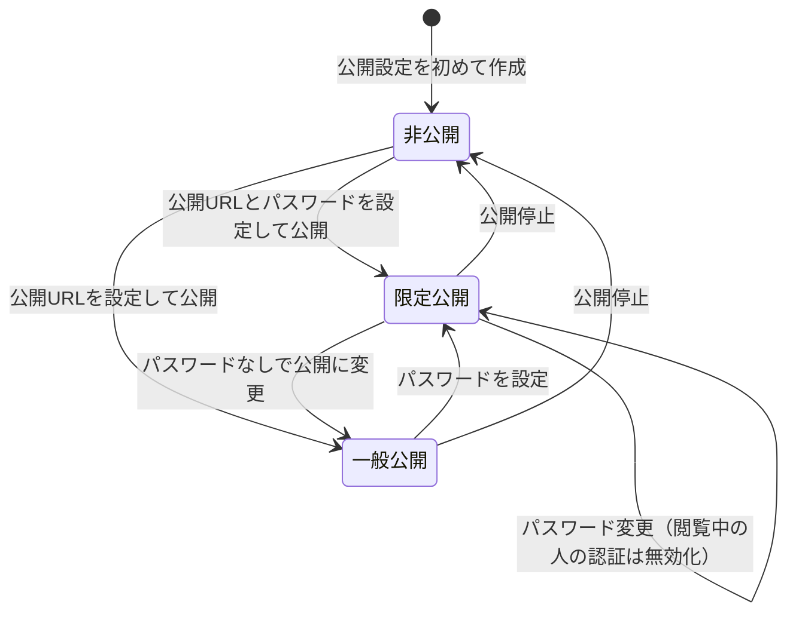
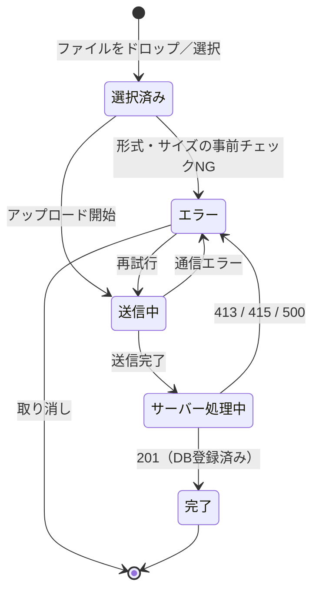
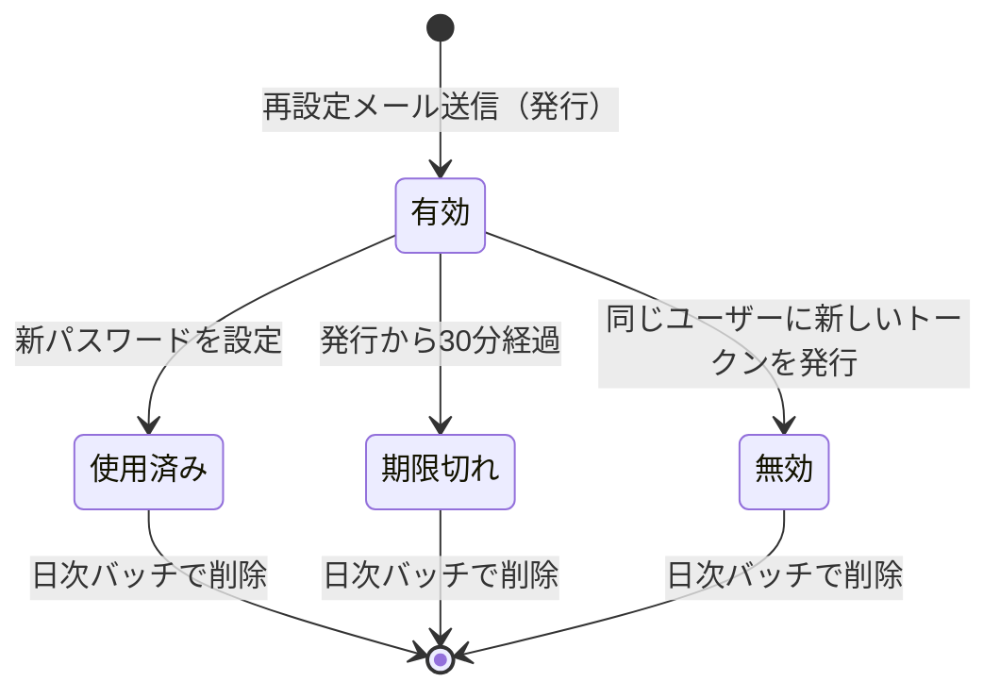
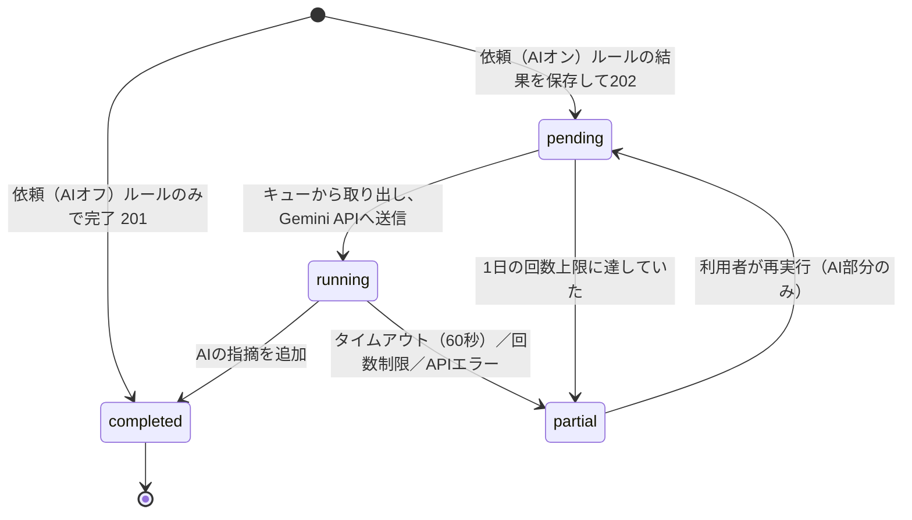
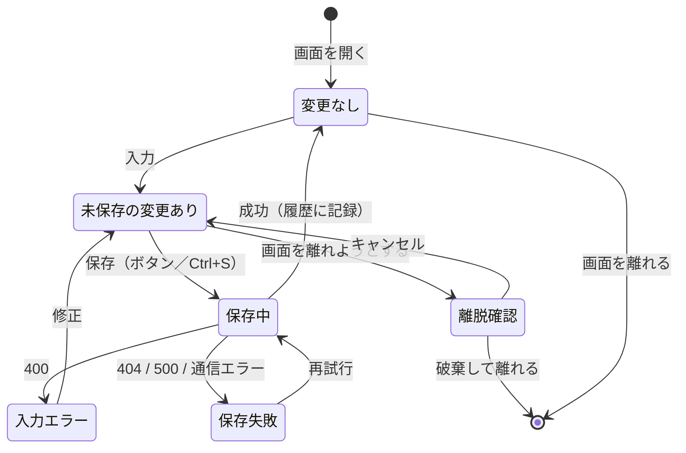

# 状態遷移図（ステートマシン図）

| 項目 | 内容 |
|---|---|
| システム名 | Artリーブ |
| 文書番号 | C101-09 |
| 版 | ver1.0 |
| 関連文書 | 04_テーブル設計書、06_API設計書 |

作成方針に従い、状態の変化が複雑で、誤るとデータや公開範囲に影響する箇所に絞って定義する。

| No | 対象 | 機能 | 状態を持つ場所 |
|---|---|---|---|
| ST-01 | 公開範囲 | F-15（将来） | public_settings.visibility |
| ST-02 | イラストのアップロード処理 | F-09 | 画面の状態（DBには完了後のみ登録） |
| ST-03 | パスワード再設定トークン | F-01 | password_reset_tokens |
| ST-04 | 矛盾チェック | F-16（将来） | consistency_checks.status |
| ST-05 | 編集画面の保存状態 | F-02、F-05、F-06 | 画面の状態 |

---

## ST-01 公開範囲（F-15、将来）

| 状態 | visibility | 公開ページ（/p/[slug]） | 必須項目 |
|---|---|---|---|
| 非公開 | private | 404 | slug |
| 限定公開 | limited | パスワード入力画面 → 正しければ閲覧可 | slug、password_hash |
| 一般公開 | public | 誰でも閲覧可 | slug |

ルール：
- 「限定公開」へ変更するときはパスワードの入力を必須にする（パスワードなしの限定公開を作らない）。
- 「一般公開」へ変更するときは、誰でも見られることを確認ダイアログで明示する。
- パスワードを変更したら、発行済みの閲覧用Cookieを無効にする（Cookieにパスワード変更日時を含めて照合）。
- 非公開に戻しても`slug`は保持し、再公開時に同じURLを使えるようにする。

---

## ST-02 イラストのアップロード処理（F-09）

| 状態 | 画面表示 |
|---|---|
| 選択済み | サムネイルのプレビュー、種類ラベル入力欄 |
| 送信中 | 進捗バー（％） |
| サーバー処理中 | 「変換中…」のスピナー |
| 完了 | ギャラリーに追加。プレビューを消す |
| エラー | 理由（「20MBを超えています」等）と再試行ボタン |

サーバー側では「サーバー処理中」に失敗した場合、途中で保存したファイルを削除してからエラーを返す（DBには完了した画像しか存在しない）。

---

## ST-03 パスワード再設定トークン（F-01）

| 状態 | 判定条件 |
|---|---|
| 有効 | `used_at IS NULL` かつ `expires_at > now()` かつ そのユーザーの最新トークン |
| 使用済み | `used_at IS NOT NULL` |
| 期限切れ | `expires_at <= now()` |
| 無効 | より新しいトークンが同じユーザーに存在する |

「有効」以外のトークンでSC-04を開いた場合は、理由を区別せず「リンクの有効期限が切れています」と表示する。

---

## ST-04 矛盾チェック（F-16、将来）

| 状態 | 画面表示 |
|---|---|
| pending | ルールの指摘を表示し、AI欄に「順番待ち…」 |
| running | ルールの指摘を表示し、AI欄に「チェック中…」 |
| completed | ルール・AIの指摘を区別して一覧表示（0件なら「矛盾は見つかりませんでした」） |
| partial | ルールの指摘を表示し、AI欄に理由（「回数制限に達しました」等）と再実行ボタン |

ルール：
- ルールチェック（自作）はその場で終わるため、失敗の状態を持たない（失敗した場合は通常のエラーとして500を返す）。
- 同じ対象に対して`pending`／`running`のチェックがあれば、新しい依頼は受け付けず既存のIDを返す。
- アプリ再起動時に`running`のまま残ったものは`partial`に戻す（B-10）。
- 依頼時点でAIチェックがオフなら、その後オンにしてもそのチェックには反映しない（`use_ai`で依頼時の設定を記録）。

---

## ST-05 編集画面の保存状態（F-02、F-05、F-06）

ルール：
- 「保存中」は保存ボタンを無効にし、二重送信を防ぐ。
- 「保存失敗」では入力内容を消さずに残し、再試行できるようにする。
