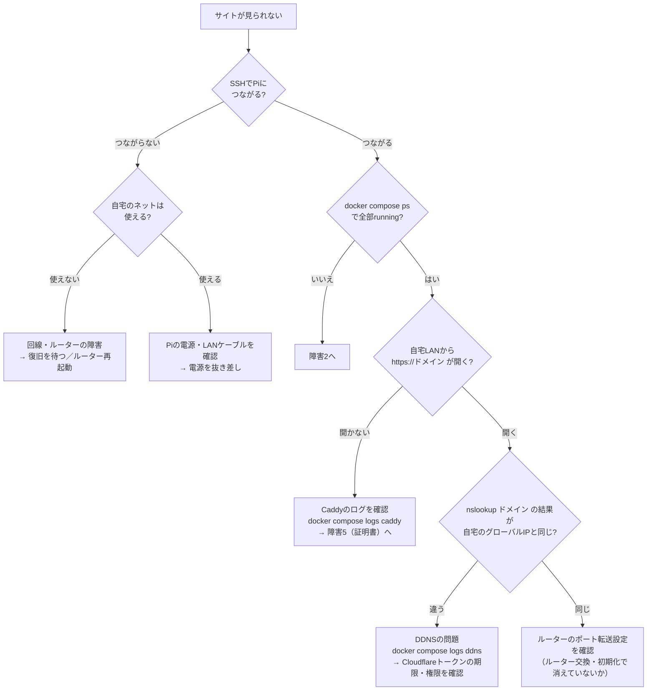

# 運用・保守・障害対応手順書

| 項目 | 内容 |
|---|---|
| システム名 | Artリーブ |
| 文書番号 | C101-12 |
| 版 | ver1.0 |
| 関連文書 | 08_インフラ・ネットワーク構成図、10_バッチ処理設計書、13_環境構築・デプロイ手順書、14_バックアップ・リストア手順書 |

---

## 1. 運用体制

| 項目 | 内容 |
|---|---|
| 運用者 | 開発者本人（1名） |
| 対応時間 | 平日夜・休日を中心としたベストエフォート |
| 通知の受け取り | UptimeRobot・Healthchecks.ioからのメール（スマートフォンで通知を受け取る設定にする） |
| 接続方法 | 自宅：LANからSSH ／ 外出先：Tailscale経由でSSH（`ssh artleave@artleave`） |

---

## 2. 定常運用

### 2.1 自動で行われること

| 内容 | タイミング | 詳細 |
|---|---|---|
| DBバックアップ・外部退避 | 毎日3:00／3:30 | 10_バッチ処理設計書 B-01、B-02 |
| 不要データ・ログの掃除 | 毎日／毎週 | B-03、B-04、B-06 |
| ディスク容量チェック | 毎時 | B-05 |
| セキュリティ更新 | 毎日 | unattended-upgrades |
| SSL証明書の更新 | 期限30日前 | Caddyが自動更新 |
| 停電後の再起動 | 通電時 | Dockerの自動起動 |

### 2.2 週次の確認（5分）

| 確認項目 | 方法 | 正常の目安 |
|---|---|---|
| バッチの結果 | Healthchecks.ioの画面 | 全ジョブが緑 |
| 稼働率 | UptimeRobotの画面 | 直近7日で99%以上 |
| ディスク使用率 | `df -h /srv/artleave` | 80%未満 |
| CPU温度 | `cat /sys/class/thermal/thermal_zone0/temp`（1000で割ると℃） | 70℃未満 |
| コンテナの状態 | `docker compose ps` | すべてrunning、再起動回数が増えていない |
| エラーログ | `docker compose logs --since 168h app \| grep -i '"level":"error"'` | 想定外のエラーがない |

### 2.3 月次の作業（30分〜1時間）

| 作業 | 手順 |
|---|---|
| OSの更新 | 3.1 |
| Dockerイメージ・npmパッケージの更新 | 3.2、3.3 |
| リストア訓練 | 14_バックアップ・リストア手順書 5章 |
| 外部ストレージの容量確認 | `rclone about gdrive:` で無料枠（15GB）の残りを確認。12GBを超えたら6章の対策 |
| 秘密情報の保管確認 | `.env`等を変更していれば、パスワード管理アプリの内容を更新 |

---

## 3. 保守作業

いずれも利用の少ない深夜（2:00〜5:00、ただしバッチの3:00〜3:45は避ける）に行う。

### 3.1 OSの更新・再起動

```bash
sudo apt update && sudo apt full-upgrade -y
[ -f /var/run/reboot-required ] && sudo reboot   # カーネル更新などで再起動が必要な場合のみ
# 再起動後、3分ほど待って確認
docker compose -f /opt/artleave/docker-compose.yml ps
curl -fsS https://artleave.example.com/api/v1/health
```

### 3.2 ミドルウェア（Docker イメージ）の更新

```bash
cd /opt/artleave
docker compose pull caddy ddns          # caddy と ddns は最新版へ
docker compose up -d caddy ddns
```

PostgreSQLは同じメジャーバージョン（16系）内の更新のみ自動で行う（`docker compose pull db && docker compose up -d db`）。メジャーバージョンアップ（16→17など）はデータ形式が変わるため、ダンプ→新バージョンで復元の手順を別途計画して行う。

### 3.3 npmパッケージの更新

開発PCで行い、通常の開発と同じくプルリクエスト経由でデプロイする。

```bash
pnpm outdated
pnpm update                 # マイナー・パッチ更新
pnpm test && pnpm build     # 問題なければPRを作成
```

メジャーバージョンアップ（Next.js、Prisma等）は、ブランチを分けて変更内容（リリースノート）を確認しながら行う。

### 3.4 デプロイ

`main`へのマージで自動実行される（13_環境構築・デプロイ手順書 第3部）。手動で実行したい場合はGitHubの「Actions」→「Deploy」→「Run workflow」、またはPiで`/opt/artleave/scripts/deploy.sh`を実行する。

### 3.5 計画停止のお知らせ

公開モード（F-15）を使い始めた後に長時間（30分以上）止める作業をする場合は、ログイン画面と公開ページにお知らせを表示する（環境変数`MAINTENANCE_NOTICE`に文言を設定してデプロイ）。

---

## 4. 障害対応

### 4.1 障害レベル

| レベル | 状況の例 | 対応の目安 |
|---|---|---|
| A（重大） | データ消失のおそれ、他人のデータが見える、サイト全体が見られない | 気づいたらすぐ |
| B（中） | 一部機能が使えない（画像が出ない、書き出しできない等）、バックアップ失敗 | 当日〜翌日 |
| C（軽微） | 表示の崩れ、遅い | 次の保守日 |

「他人のデータが見える」不具合を見つけた場合は、原因調査より先に`docker compose stop app`でサービスを止める。

### 4.2 共通の初動

```bash
ssh artleave@artleave                    # つながらなければ「障害1」へ
cd /opt/artleave
docker compose ps                        # 止まっている・再起動を繰り返しているコンテナ
docker compose logs --tail 100 app       # 直前のエラー
df -h /srv/artleave                      # 容量
uptime                                   # 負荷・起動からの時間（停電で再起動していないか）
```

対応した内容は7章の障害記録に残す。

---

### 障害1：サイトにまったくアクセスできない



### 障害2：コンテナが止まっている・再起動を繰り返す

| 止まっているもの | よくある原因 | 対応 |
|---|---|---|
| app | DBに接続できない | `docker compose logs db`を確認し、dbを先に直す |
| app | マイグレーションの失敗（デプロイ直後） | ログに`prisma migrate`のエラーが出る → 13 第3部 3.4で切り戻し |
| app | メモリ不足（`Killed`、終了コード137） | `free -h`で確認。書き出しの同時実行などを見直す |
| db | ディスク容量不足 | 障害4へ |
| db | データファイルの破損（停電直後など） | ログに`PANIC`や`invalid page`が出る → 14 4.1でDB復元 |
| caddy | 設定ファイルの誤り | `docker compose exec caddy caddy validate --config /etc/caddy/Caddyfile` |

いずれも原因を取り除いた後、`docker compose up -d`で起動する。

### 障害3：画面は出るが一部の機能がおかしい

| 症状 | 確認 | 対応 |
|---|---|---|
| イラストが表示されない | ファイルの有無：`ls /srv/artleave/uploads/<userId>/<characterId>/` | なければ14 4.2で復元。権限が違えば`sudo chown -R 1001:1001 /srv/artleave/uploads` |
| アップロードできない | ディスク容量、`docker compose logs app`のエラー | 容量なら障害4。形式エラーなら利用者側の問題 |
| パスワード再設定メールが届かない | ログのSMTPエラー | Gmailのアプリパスワードが無効になっていないか確認し、再発行して`.env`を更新 |
| 書き出しが終わらない | ログ、`docker stats`のCPU使用率 | 大量の書き出しが詰まっていればappを再起動 |
| 動作が極端に遅い | `docker stats`、CPU温度 | 温度が80℃を超えていれば熱で性能が落ちている。ファン・置き場所を見直す |

### 障害4：ディスク容量不足（B-05の通知）

```bash
sudo du -sh /srv/artleave/* | sort -h       # どこが大きいか
docker system df                            # Dockerのイメージ・ビルドキャッシュ
```

| 原因 | 対応 |
|---|---|
| 古いDockerイメージ・ビルドキャッシュ | `docker image prune -a -f && docker builder prune -f` |
| 古いデプロイ前・復元前ダンプ | `/srv/artleave/backups/db/`の`predeploy_*`、`before_restore_*`の古いものを削除 |
| イラストの増加 | 想定どおりの増加なら、より大きいSSDへ移行する（14 4.3の手順を応用） |
| ログの肥大化 | `/srv/artleave/logs`、Caddyのアクセスログの設定を確認 |

### 障害5：SSL証明書のエラー（ブラウザに警告が出る）

```bash
docker compose logs caddy | grep -i -E "certificate|acme|error"
```

| 原因 | 対応 |
|---|---|
| 80番ポートに外から届かず更新できない | ルーターのポート転送・ufwの設定を確認 |
| DNSが別のIPを指している | 障害1の「DDNSの問題」へ |
| Let's Encryptの発行回数制限 | 何度も作り直した場合に起きる。数時間〜1週間待つ（`/srv/artleave/caddy/data`を消さない） |

確認後`docker compose restart caddy`。

### 障害6：バックアップの失敗（B-01／B-02の通知）

```bash
tail -n 50 /srv/artleave/logs/batch/B-01_$(date +%Y%m%d).log
tail -n 50 /srv/artleave/logs/batch/B-02_$(date +%Y%m%d).log
```

| 原因 | 対応 |
|---|---|
| dbコンテナが止まっている | 障害2 |
| ディスク容量不足 | 障害4 |
| Google ドライブの認証切れ（`token expired`等） | `rclone config reconnect gdrive:`で再認証 |
| Google ドライブの容量不足 | 6章 |
| 一時的なネットワークエラー | 手動で再実行：`/opt/artleave/scripts/run-job.sh B-02 /opt/artleave/scripts/sync-offsite.sh` |

2日以上続けて失敗した状態を放置しない（RPO 24時間を守れなくなるため）。

### 障害7：SSD故障・Piが起動しない

14_バックアップ・リストア手順書「4.3 全体復旧」に従う。

### 障害8：不正アクセスが疑われる

1. `docker compose stop app`でサービスを止める
2. Caddyのアクセスログ（`/srv/artleave/caddy/data/access.log`）、`/var/log/auth.log`で不審なアクセスを確認
3. `AUTH_SECRET`を新しい値に変える（全員のログインが無効になる）。必要ならDBのパスワード、Cloudflare・Tailscaleの鍵も変える
4. 原因を特定・修正してから再開する。データが改ざんされていれば、改ざん前のバックアップから復元する

---

## 5. 停電・回線断の後の確認

通常は自動で復旧する。復旧通知（UptimeRobotの「Up」メール）が届かない場合のみ、障害1に従って確認する。停電が頻繁に起きる場合は小型UPSの導入を検討する。

---

## 6. 外部ストレージの容量対策

Google ドライブの無料枠（15GB、Gmail等と共用）に近づいた場合：

1. `uploads-deleted`（削除済みイラストの保管）の保持期間を30日から短くする
2. 外部に送るDBダンプを週次のみにする
3. それでも足りなければ、Google Oneの最小プラン（月額数百円）への移行、または別の無料ストレージの併用を検討する

---

## 7. 障害記録（様式）

| 発生日時 | レベル | 症状 | 原因 | 対応内容 | 復旧日時 | 再発防止策 |
|---|---|---|---|---|---|---|
| | | | | | | |
